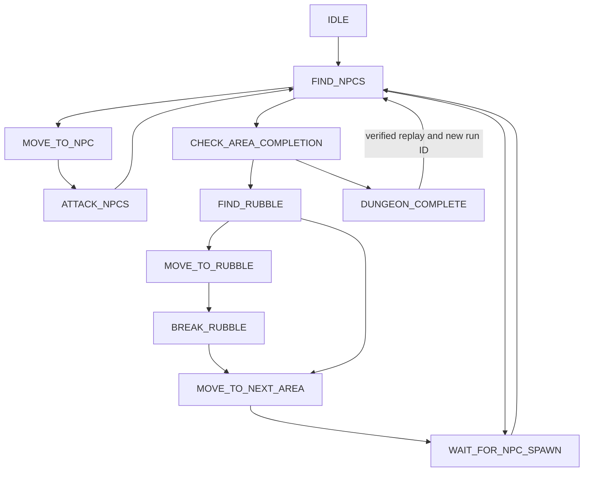

# Mohammad and Ali Script

**MOHAMMAD & ALI — ANIME ZERO | AUTOMATION HUB**

An independent, modular Luau dungeon controller with a charcoal, cyan, and purple dashboard. It coordinates enemies, rubble, area entry, delayed waves, completion, and optional replay through an explicit game adapter.

**Anime Zero integration is not configured or verified.** The included Roblox Studio fixture and deterministic tests demonstrate the controller using mechanics owned by this project. No third-party loader or obfuscated implementation is used. Develop the modular source with Rojo, or distribute the self-contained client without VS Code or Rojo.

## Single-file distribution and GitHub command

`loader.lua` is a generated, readable client bundle containing all **24 modules**. It opens the GUI on startup, leaves automation idle, and does not download any other code or require installed ModuleScripts. Repeated execution reveals the existing GUI and reuses its controller. Concurrent initialization is rejected; failed construction rolls back partial resources.

After the file has been published to the accessible `main` branch, your requested command is:

```lua
loadstring(game:HttpGet("https://raw.githubusercontent.com/Mohammed001200/anime-zero-script/main/loader.lua"))()
```

**Environment requirement:** this exact command requires a client host that supplies both `game:HttpGet` and `loadstring`. It is not a supported ordinary Roblox LocalScript command. Roblox's documented `LoadStringEnabled` controls **server** scripts; it does not enable client loadstring, and this GUI bundle rejects server execution. See [Roblox loadstring documentation](https://create.roblox.com/docs/reference/engine/globals/LuaGlobals), [LoadStringEnabled](https://create.roblox.com/docs/reference/engine/classes/ServerScriptService), and [the supported HTTP service](https://create.roblox.com/docs/reference/engine/classes/HttpService).

For a normal Studio/client installation in a place you control, create a **LocalScript in StarterPlayerScripts** and paste the complete contents of `dist/MohammadAndAli.client.lua` into it. That file is byte-for-byte identical to `loader.lua` and needs no loadstring, HTTP access, VS Code, Rojo, or ReplicatedStorage package at runtime. Actual Roblox execution and GUI rendering still require a Studio playtest. The standalone client does not install the demo server or supply Anime Zero bindings.

The raw GitHub URL returned **HTTP 404 on 2026-10-15**. These files are prepared locally and **have not been pushed**, so the remote command is not yet available. Private repositories also need appropriate access; this loader does not embed credentials.

To rebuild after editing `src/` (Python 3.10+ and its standard library):

```powershell
python scripts/bundle.py
python scripts/bundle.py --check
```

Keep `loader.lua`, `dist/MohammadAndAli.client.lua`, and `dist/manifest.json` together in the reviewed changes. The manifest lists source hashes, dependencies, and their order. CI fails if the distribution is stale. Read [DISTRIBUTION.md](docs/DISTRIBUTION.md) for the environment matrix, rollback behavior, and release checks.

## Quick start

Open this repository folder in VS Code. Install the versions in `aftman.toml` (or put their official binaries on PATH), then run:

```powershell
aftman install
./scripts/verify.ps1
rojo serve default.project.json
```

Connect the Rojo Studio plugin to the local server in a **new empty test place**, sync, and press **Play**. On Dashboard, choose **START RUN**. The server creates a separate five-area training lane per player. Each area spawns three NPCs after a two-second delay; areas 1–4 include rubble, and area 5 completes the dungeon. The client never applies damage itself: the demo server validates target ownership, run identity, area, health, attack rate, and distance.

Alternatively, verification generates `build/MohammadAndAli-Demo.rbxlx`; open that file in Studio and press Play. `build/MohammadAndAli-Integration.rbxlx` excludes the demo server and is a reference integration build, **not a verified Anime Zero release**.

See [setup](docs/SETUP.md) for commands without Aftman and a Studio acceptance walkthrough.

## Implemented behavior and verification

| Component | Implemented | Evidence / remaining work |
| --- | --- | --- |
| Five-area controller, scoped targeting, rubble, progression, completion | Yes | Deterministic five-area simulation passes |
| Delayed spawns, despawn, respawn recovery, cancellation, replay, timeouts | Yes | Automated regression tests pass |
| Native Humanoid movement and cancellable pathfinding | Yes | Compiles and packages; requires Studio navigation testing |
| Six-tab UI, toggles, sliders, dropdowns, live status, notifications, drag, restore, emergency stop | Yes | Compiles and packages; requires Studio visual/input testing |
| Studio demo server, per-player lanes, validated combat and replay | Yes | Builds successfully; actual Studio multiplayer playtest pending |
| Preferences | Yes | Configuration round-trip tested; demo server-session storage needs Studio verification |
| Anime Zero hierarchy, combat, rubble interaction, progression, replay | Blocked by missing verified game details | No live access or legitimate integration API has been supplied |

Current automated result: **50 Luau tests and 8 Python build tests pass**, all **38 Luau files compile**, formatting passes, and all three Rojo projects build. Loader tests construct the actual UI code against mocked client services; they do not render it or execute Roblox services. See [validation details](docs/VALIDATION.md).

## Architecture

```text
main.client.lua              Roblox client entry point
loader.lua                   Generated self-contained GitHub entry point
dist/                       Identical standalone client and dependency/hash manifest
src/
  Bootstrap.lua              Single session, heartbeat, reload and teardown ownership
  Core/                      State machine, controller, validated config, bounded logging
  Game/                      Adapter contract, detectors, combat, Studio adapter, integration bindings
  Dungeon/                   Objective priority and area progression decisions
  Movement/                  Portable navigation policy and Roblox pathfinding driver
  UI/                        Theme, components, notifications, six-tab window
  Utils/                     Signals, cleanup, finite point geometry
demo/Dungeon.server.lua     Studio-only authoritative five-area fixture
tests/                      Dungeon, loader-startup, and dependency/build regressions
scripts/                    Bundler, compiler checks, and verification commands
docs/                       Setup, debugging, integration contract, validation
```

The portable decision engine receives plain point records and one coherent snapshot. Only the Roblox movement driver, UI, bootstrap, and Studio demo depend on engine services. Modules use Roblox `script` references in Studio and relative requires under Lune.

## State machine



This is a reactive controller: each tick revalidates the current run, area, character, and targets. It can leave any active phase for recovery, error, or an explicit stop. Target disappearance and unexpected area changes cancel stale actions before choosing another objective.

An empty target collection **never implies completion**. The controller needs authoritative `areaCleared` with no pending spawn, then resolves active rubble and a verified next entrance. Final completion requires `completed`, rather than guessing from “5/5” or missing enemies. Missing objectives cause timed waiting and bounded recovery. There is no spawn-return destination or teleport fallback in the controller.

Navigation has one owner, generation cancellation for asynchronous path computation, stand-off destinations, finite position checks, stuck detection, and an overall timeout. Combat requests are rate-limited and stop if target health makes no progress. Stop cancels movement and combat immediately; already-sent server requests cannot be recalled.

## Controls and configuration

- **Dashboard:** Start/Stop, current area, target, controller state, NPC count, barrier status, destination, last error, four automation preferences.
- **Auto Farm:** NPC farming, nearest/lowest-health targeting, acquisition range, attack range, follow distance, target refresh, attack interval, health-progress timeout.
- **Dungeon:** Rubble, next area, timed spawn waiting, replay, progress, objective timeout, recovery limit, manual recovery.
- **Movement:** Pathfinding/direct MoveTo, optional speed override, stuck detection and timeouts. Height offsets are explicitly unsupported by this ground driver.
- **Settings:** Hide, minimize, notifications, debug logs, save, reset. Unsupported capabilities are labelled or disabled.
- **Credits:** Project name, dedication, version, integration status.

**Right Shift** toggles the window; **End** triggers emergency stop. The footer emergency button is always available while the window is open. Hiding/minimizing keeps the controller running; the floating M/A button restores the window. Preferences never automatically start a run.

All preferences flow through `Core/Configuration.lua`; follow distance cannot exceed attack range. The desktop sidebar becomes a compact top navigation bar on smaller screens. Sliders support pointer/touch dragging and keyboard/gamepad directional adjustment; button-based controls use `Activated`.

The Studio demo retains saved preferences for the current server session, including GUI reloads. It does not use DataStore or executor filesystem APIs. A production preference binding must provide its own authorized persistence and truthful save result.

## Testing

```powershell
python scripts/bundle.py --check
python -m unittest discover -s tests -p '*_test.py' -v
lune run scripts/check.luau
lune run tests/run.luau
stylua --check src demo tests scripts main.client.lua
New-Item -ItemType Directory -Force build
rojo build default.project.json --output build/MohammadAndAli-Demo.rbxlx
rojo build production.project.json --output build/MohammadAndAli-Integration.rbxlx
rojo build standalone.project.json --output build/MohammadAndAli-Standalone.rbxlx
git diff --check
```

`scripts/verify.ps1` runs distribution freshness, dependency/build tests, compilation, Luau tests, formatting, three builds, and whitespace checks, stopping on failure. It prefers `.tools/*.exe` when present, then PATH. Local tool binaries and `build/` place files are ignored by Git; `loader.lua` and `dist/` deliverables are included. CI runs equivalent checks on Linux.

The portable fixture verifies this order, including clear-before-rubble-before-entry assertions:

```text
Area 1 → NPCs → Rubble → Area 2 → NPCs → Rubble
       → Area 3 → NPCs → Rubble → Area 4 → NPCs → Rubble
       → Area 5 → NPCs → Confirmed completion
```

## Connect verified game mechanics

Begin with [GAME_INTEGRATION.md](docs/GAME_INTEGRATION.md). `src/Game/Integration.lua` deliberately returns no bindings. Supply authorized snapshot/combat/replay functions only after observing and documenting the game's actual hierarchy and available mechanics. Use `production.project.json` to exclude demo code from the place.

If Anime Zero does not expose a legitimate integration mechanism, use this project in a Studio place you control. Merely running a LocalScript cannot create server authority in another developer's game. No remotes, object names, license bypasses, or anti-cheat evasion techniques have been invented here.

## Known limits

- No live Anime Zero behavior is verified, including damage, rubble health, entrance discovery, completion, and replay.
- Actual Studio GUI layout, mobile input, pathfinding, server replication, and multiplayer isolation require the acceptance pass in SETUP.md.
- Adapters must supply coherent snapshots and non-yielding callbacks. Network work must be asynchronous and expose cached state.
- Streaming omissions must not be reported as area clears. Missing or contradictory state causes waiting/recovery.
- User-selected ranges and speeds do not override server rules. Combat with no health progress times out.
- The included movement driver uses a fixed humanoid agent shape; unusual rigs or dungeon geometry may need driver tuning.
- The bounded recovery budget resets on a new area/run/character, or explicit manual recovery/start.

For errors and useful integration evidence, see [DEBUGGING.md](docs/DEBUGGING.md).
